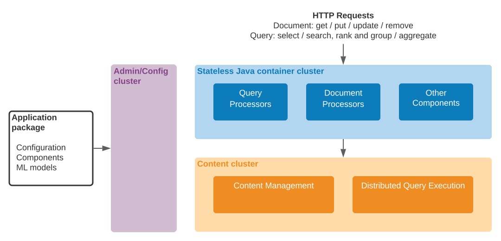
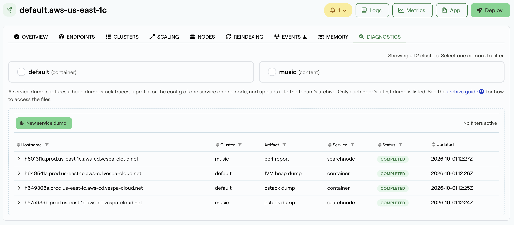

## Manual deployments

Developers will typically deploy their application to the `dev` [zone](/en/operations/zones) during development. Each deployment is owned by a *tenant*, and each specified *instance* is a separate copy of the application; this lets developers work on independent copies of the same application, or collaborate on a shared one, as they prefer—more details [here](/en/learn/tenant-apps-instances). These values can be set in the Vespa Cloud UI when deploying, or with each of the build and deploy tools, as shown in the respective getting-started guides.

Additionally, a deployment may specify a different [zone](/en/operations/zones) to deploy to, instead of the default `dev` zone.

### Auto downsizing

Deployments to `dev` are downscaled to one small node by default, so that applications can be deployed there without changing `services.xml`. See [performance testing](#performance-testing) for how to disable auto downsizing using `deploy:environment="dev"`.

### Availability

The `dev` zone is a sandbox and not for production serving; It has no uptime guarantees.

An automated Vespa software upgrade can be triggered at any time, and this may lead to some downtime if you have only one node per cluster (as with the default [auto downsizing](#auto-downsizing)).

## Performance testing

For performance testing, to avoid auto downsizing, lock the [resources](/en/reference/applications/services/services) using `deploy:environment="dev"`:

```xml
<nodes deploy:environment="dev" count="1">
    <resources vcpu="8.0"
               memory="64Gb"
               disk="474Gb"
               architecture="arm64"
               storage-type="local"/>
</nodes>
```

Read more in [benchmarking](/en/performance/benchmarking-cloud) and [variants in services.xml](/en/operations/deployment-variants).

## Component overview

<Frame>

</Frame>

Application packages can contain Java components to be run in container clusters. The most common component types are:

- [Searchers](/en/applications/searchers), which can modify or build the query, modify the result, implement workflows issuing multiple queries etc.
- [Document processors](/en/applications/document-processors) that can modify incoming write operations.
- [Handlers](/en/applications/request-handlers) that can implement custom web service APIs.
- [Renderers](/en/applications/result-renderers) that are used to define custom result formats.

Components are constructed by dependency injection and are reloaded safely on deployment without restarts. See the [container documentation](/en/applications/containers) for more details.

See [deploy an application having Java components](/en/basics/deploy-an-application-java), and [troubleshooting](/en/operations/self-managed/admin-procedures#troubleshooting).

## Developing Components

The development cycle consists of creating the component, deploying the application package to Vespa, writing tests, and iterating. These steps refer to files in [album-recommendation-java](https://github.com/vespa-engine/sample-apps/tree/master/album-recommendation-java):

<table className="vespa-table">
  <thead>
    <tr>
      <th></th>
      <th></th>
    </tr>
  </thead>
  <tbody>
    <tr>
      <td><strong>Build</strong></td>
      <td>All the Vespa sample applications use the <a href="/en/applications/bundles#maven-bundle-plugin" aria-label="bundle plugin">bundle plugin</a> to build the components.</td>
    </tr>
    <tr>
      <td><strong>Configure</strong></td>
      <td>A key Vespa feature is code and configuration consistency, deployed using an <a href="/en/basics/applications" aria-label="application package">application package</a>. This ensures that code and configuration is in sync, and loaded atomically when deployed. This is done by generating config classes from config definition files. In Vespa and application code, configuration is therefore accessed through generated config classes. The Maven target <code>{`generate-sources`}</code> (invoked by <code>{`mvn install`}</code>) uses <a href="https://github.com/vespa-engine/sample-apps/blob/master/album-recommendation-java/app/src/main/resources/configdefinitions/metal-names.def" aria-label="metal-names.def">metal-names.def</a> to generate <code>{`target/generated-sources/vespa-configgen-plugin/com/mydomain/example/MetalNamesConfig.java`}</code>. After generating config classes, they will resolve in tools like <a href="https://www.jetbrains.com/idea/download/" aria-label="IntelliJ IDEA">IntelliJ IDEA</a>.</td>
    </tr>
    <tr>
      <td><strong>Tests</strong></td>
      <td>Examples unit tests are found in <a href="https://github.com/vespa-engine/sample-apps/blob/master/album-recommendation-java/app/src/test/java/ai/vespa/example/album/MetalSearcherTest.java" aria-label="MetalSearcherTest.java">MetalSearcherTest.java</a>. <code>{`testAddedOrTerm1`}</code> and <code>{`testAddedOrTerm2`}</code> illustrates two ways of doing the same test: The first setting up the minimal search chain for <a href="/en/querying/query-language" aria-label="YQL">YQL</a> programmatically. The second uses <a href="https://javadoc.io/doc/com.yahoo.vespa/application/latest/com/yahoo/application/Application" aria-label="`com.yahoo.application.Application`"><code>{`com.yahoo.application.Application`}</code></a>, which sets up the application package and simplifies testing. Read more in <a href="/en/applications/unit-testing" aria-label="unit testing">unit testing</a>.</td>
    </tr>
  </tbody>
</table>

## Debugging Components

<Warning>
**Important:**

The debugging procedure only works for endpoints with an open debug port - most managed services don't do this for security reasons.
</Warning>

Vespa Cloud does not allow debugging over the *Java Debug Wire Protocol (JDWP)* due to the protocol's inherent lack of security measures. If you need interactive debugging, deploy your application to a self-hosted Vespa installation (below) and manually [add the *JDWP* agent to JVM options](#debugging-components).

You may debug your Java code by requesting either a JVM heap dump or a Java Flight Recorder recording through the [Vespa Cloud Console](https://console.vespa-cloud.com/). Open the deployment of your application, go to the _Diagnostics_ tab, and select _New service dump_. Pick a _container_ cluster, one of its nodes, and the _JVM heap dump_ or _JVM Java Flight Recorder data_ artifact. Note that a heap dump pauses the JVM while it is written, so the node may stop serving until it finishes. The dump takes up to a few minutes, and is listed on the _Diagnostics_ tab while it runs. Once it has completed, expand its row to find the steps to download it from your [archive](/en/operations/archive/archive-guide). Extract the files from the downloaded Zstandard-compressed archive, and use the free [JDK Mission Control](https://www.oracle.com/java/technologies/jdk-mission-control.html) utility to inspect the dump/recording.

<Frame>

</Frame>

To debug a [Searcher](/en/applications/searchers) / [Document Processor](/en/applications/document-processors) / [Component](/en/applications/components) running in a self-hosted container, set up a remote debugging configuration in the IDEA - IntelliJ example:

1. Run -&gt; Edit Configurations...
2. Click `+` to add a new configuration.
3. Select the "Remote JVM Debug" option in the left-most pane.
4. Set hostname to the host running the container, change the port if needed.
5. Set the container's [jvm options](/en/reference/applications/services/container#jvm) to the value in "Command line arguments for remote JVM":
   ```xml highlight={3}
   <container id="default" version="1.0">
       <nodes>
           <jvm options="-agentlib:jdwp=transport=dt_socket,server=y,suspend=n,address=*:5005" />
   ```
6. Re-deploy the application, then restart Vespa on the node that runs the container. Make sure the port is published if using a Docker/Podman container, e.g.:
   ```console highlight={2}
   $ docker run --detach --name vespa --hostname vespa-container \
     --publish 127.0.0.1:8080:8080 --publish 127.0.0.1:19071:19071 --publish 127.0.0.1:5005:5005 \
     vespaengine/vespa
   ```
7. Start debugging! Check _vespa.log_ for errors.

## Developing system and staging tests

When using Vespa Cloud, system and tests are most easily developed using a test deployment in a `dev` zone to run the tests against. Refer to [general testing guide](/en/applications/testing) for a discussion of the different test types, and the [basic HTTP tests](/en/reference/applications/testing) or [Java JUnit tests](/en/reference/applications/testing-java) reference for how to write the relevant tests.

If using the [Vespa CLI](/en/clients/vespa-cli) to deploy and run [basic HTTP tests](/en/reference/applications/testing), the same commands as in the test reference will just work, provided the CLI is configured to use the `cloud` target.

### Running Java tests

With Maven, and [Java Junit tests](/en/reference/applications/testing-java), some additional configuration is required, to infuse the test runtime on the local machine with API and data plane credentials:

```console
$ mvn test \
-D test.categories=system \
-D dataPlaneKeyFile=data-plane-private-key.pem -D dataPlaneCertificateFile=data-plane-public-cert.pem \
-D apiKey="$API_KEY"
```

The `apiKey` is used to fetch the *dev* instance's endpoints. The data plane key and certificate pair is used by [ai.vespa.hosted.cd.Endpoint](https://github.com/vespa-engine/vespa/blob/master/cloud/tenant-cd-api/src/main/java/ai/vespa/hosted/cd/Endpoint.java) to access the application endpoint. Note that the `-D vespa.test.config` argument is gone; this configuration is automatically fetched from the Vespa Cloud API—hence the need for the API key.

When running Vespa self-hosted like in the [sample application](/en/basics/deploy-an-application-local), no authentication is required by default, to either API or container, and specifying a data plane key and certificate will instead cause the test to fail, since the correct SSL context is the Java default in this case.

Make sure the TestRuntime is able to start. As it will init an SSL context, make sure to remove config when running locally, in order to use a default context. Remove properties from *pom.xml* and IDE debug configuration.

Developers can also set these parameters in the IDE run configuration to debug system tests:

```txt
-D test.categories=system
-D tenant=my_tenant
-D application=my_app
-D instance=my_instance
-D apiKeyFile=/path/to/myname.mytenant.pem
-D dataPlaneCertificateFile=data-plane-public-cert.pem
-D dataPlaneKeyFile=data-plane-private-key.pem
```

## Tips and troubleshooting

- Vespa Cloud upgrades daily, and applications in `dev` also have their Vespa platform upgraded. This usually happens at the opposite time of day of when deployments are made to each instance, and takes some minutes. Deployments without redundancy will be unavailable during the upgrade.
- Failure to deploy, due to authentication (HTTP code 401) or authorization (HTTP code 403), is most often due to wrong configuration of `tenant` and/or `application`, when using command line tools to deploy. Ensure the values set with Vespa CLI or in `pom.xml` match what is configured in the UI.
- In case of data plane failure, remember to copy the public certificate to `src/main/application/security/clients.pem` before building and deploying. This is handled by the Vespa CLI `vespa auth cert` command.
- To run Java [system and staging tests](/en/reference/applications/testing-java) in an IDE, ensure all API and data plane keys and certificates are configured in the IDE as well; not all IDEs pick up all settings from `pom.xml` correctly:

  ```txt
  -Dtest.categories=system
  -DapiKeyFile=/path-to/tname.pem
  -DdataPlaneCertificateFile=/path-to/data-plane-public-cert.pem
  -DdataPlaneKeyFile=/path-to/data-plane-private-key.pem
  ```
