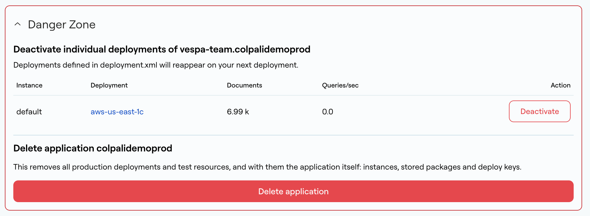

<Warning>
**Warning:** 

Following these steps will remove production instances or regions and all data within them. Data will be unrecoverable.
</Warning>


## Deleting an application

To delete an application, use the [console](https://console.vespa-cloud.com):

1. Under **Applications**, select the application and open **Application Overview**.
1. Expand the **Danger Zone** section at the bottom of the page.
1. Click **Delete application**.

<Frame>

</Frame>

This removes all production deployments and test resources, and with them the application itself: its instances, stored application packages and deploy keys. Remove the CI job that builds and deploys application packages, if any, so it does not deploy the application again.

To take a single production deployment offline instead, click **Deactivate** next to it in the **Danger Zone**. A deactivated deployment that is still listed in `deployment.xml` reappears on the next deployment. To remove it permanently, follow the steps in the next section.

## Deleting an instance / region

To remove an instance or a deployment to a region from an application:

<Steps>
<Step>
Remove the `region` from `prod`, or the `instance` from `deployment` in [deployment.xml](/en/reference/applications/deployment#instance):
```xml
<deployment version="1.0">
     <prod>
         <region>aws-us-east-1c</region>
         <!-- Removing the deployment in the region 'aws-eu-west-1a' -->
         <!--region>aws-eu-west-1a</region-->
     </prod>
 </deployment>
```
</Step>
<Step>
Add or modify [validation-overrides.xml](/en/reference/applications/validation-overrides), allowing Vespa Cloud to remove production instances:
	
```xml
<validation-overrides>
    <allow until="2021-03-01" comment="Remove region/instance ...">deployment-removal</allow>
    <!-- If the region was part of a global endpoint/instance had a global endpoint: -->
    <allow until="2021-03-01" comment="Remove region/instance ...">global-endpoint-change</allow>
</validation-overrides>
```
</Step>
<Step>
Build and deploy the application package.
</Step>
</Steps>