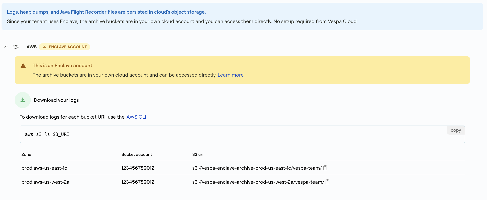

---
# Copyright Vespa.ai. All rights reserved.
title: Vespa Cloud Enclave Log Archive
applies_to: cloud
redirect_from:
- /en/cloud/enclave/archive
---

Refer to the [Artifact Archive](../archive/archive-guide.html) for general information about logs and artifacts like heap dumps.

After Vespa Cloud Enclave is set up,
a storage bucket is created per Vespa Cloud zone you configured in the enclave.
As the buckets are in your own cloud account,
you can access the archive buckets directly using your existing cloud credentials:



There is one storage bucket per Vespa Cloud Zone that is configured in the enclave.
The name of the bucket depends on the cloud provider you are setting up the enclave in.

Files are synchronized to the archive bucket when the file is rotated by the logging system,
or when a virtual machine is deprovisioned from the application.  The consequence of this is
that frequency of uploads will depend on the activity of the Vespa application.


## Directory structure
The directory structure in the bucket for logs and heap dumps is as follows:

```
<tenant>/<application>/<instance>/<host>/logs/<logtype>/<logfile>

<tenant>/<application>/<instance>/<host>/service-dump/<file>
```

* `tenant` is the tenant ID.
* `application` is the application ID that generated the log.
* `instance` is the instance ID of the generated log, e.g. `default`.
* `host` is the name prefix of the host that generated the log, e.g. `e103a`.
* `logtype` is the type of log in the directory (see below).
* `logfile` is the specific file of the log.




## Log types
There are three log types that are synced to this bucket.

* `vespa`: [Vespa logs](../../reference/operations/log-files.html)
* `access`: [Access logs](../access-logging.html)
* `connection`: [Connection logs](../access-logging.html#connection-log)
