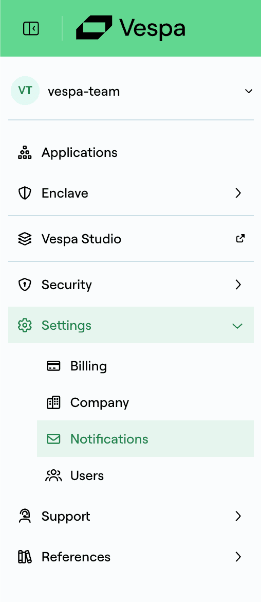

Vespa Cloud supports two different categories of notifications. Notifications can be sent by email if this has been configured in the Console.

- **Tenant notifications** are administrative notifications about the tenant. Information about users, plan, etc. are sent to all contacts configured to get tenant notifications.
- **Application notifications** are notifications about your running Vespa applications. If there are resource constraint issues, deployment errors, configuration errors or other issues with a Vespa application, they will be sent to all contacts configured to get application notifications.

## Configuring Notifications

Notifications are configured in the Console. In the sidebar, expand **Settings** and select [**Notifications**](https://console.vespa-cloud.com/link/tenant/settings/notifications).  You can add contacts here that will start receiving emails for the categories enabled for that contact.

<Frame>

</Frame>

To add a new address to get notifications:

<Steps>
<Step>
Click **+Add new contact**.
</Step>
<Step>
Enter the email address to receive notifications to.
</Step>
<Step>
Choose the types of notifications to receive.
</Step>
<Step>
Click **Save**
</Step>
<Step>
Go to your email inbox and click the verification link you have received there.
</Step>
</Steps>