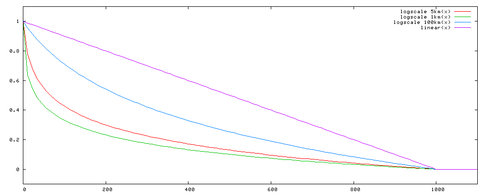
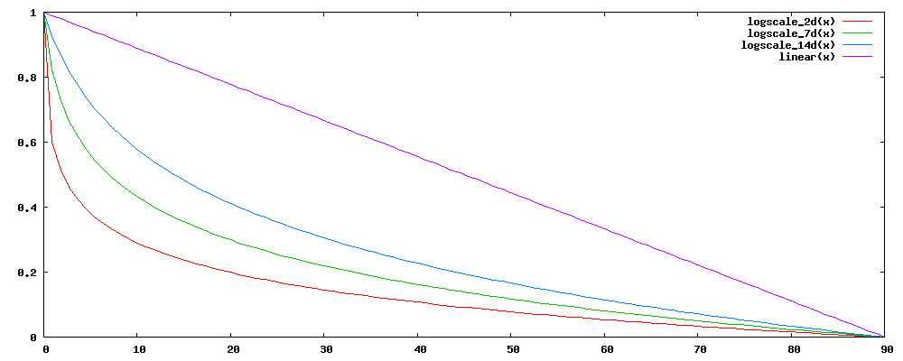

import { Feature } from "/snippets/feature.jsx";

This is the list of the rank features in Vespa. These features are available during document ranking for combination into a complete rank score by a [ranking expression](/en/reference/ranking/ranking-expressions). The features are a combination of coarse grained features suitable for handwritten expressions, and finer grained features suitable for machine learning.

See also [the overview of the ranking framework](/en/basics/ranking), and [rank feature configuration parameters](/en/reference/ranking/rank-feature-configuration). Notes:

- Types: All rank feature values are doubles or tensors. Integers are converted to exact whole value doubles. String values are converted to exact whole value doubles using a hash function. String literals in ranking expressions are converted using the same hash function, to enable equality tests on string values.
- Features which are _normalized_ are between 0 and 1, where 0 is always the minimum and 1 the maximum. Normalized features should normally be preferred because they are more easily combined by [ranking expressions](/en/reference/ranking/ranking-expressions) into a complete normalized score.
- A query may override _any_ rank feature value by submitting that value as a feature with the query.
- Some features have parameters. It is always allowed to quote parameters with _"_. Nested quotes are not allowed and must be escaped using <em>\\</em>. Parameters that can be parsed as feature names may be left unquoted. Examples: _foo(bar(baz(5.5)))_, _foo("bar(\\"baz(\\\\\\"5.5\\\\\\")\\")")_, _foo("need quote")_

### Feature list

<a id="rank-feature-table" />

#### Query features

<Feature name="query(_value_)" default="0">

An application specific feature submitted with the query, see [using the query feature](/en/ranking/ranking-expressions-features#using-query-variables).

</Feature>

<Feature name="term(_n_).significance" default="0">

A normalized number (between 0.0 and 1.0) describing the significance of the term; used as a multiplier or weighting factor by many other text matching rank features.

This should ideally be set by a searcher in the container for global correctness as each node will estimate the significance values from the local corpus. Use the [Java API for significance](https://javadoc.io/doc/com.yahoo.vespa/container-search/latest/com/yahoo/prelude/query/TaggableItem.html#setSignificance(double)) or [YQL annotation for significance](/en/reference/querying/yql#significance).

As a fallback, a significance based on Robertson-Sparck-Jones term weighting is used; it is logarithmic from 1.0 for rare terms down to 0.5 for common terms (those occurring in every document seen).

Note that "rare" is defined as a frequency of 0.000001 or less. This is the term document frequency (how many documents contain the term out of all documents that can be observed), so you cannot get 1.0 as the fallback until you actually have a large number of documents (minimum 1 million) in the same search process.

See [numTerms](/en/reference/ranking/rank-feature-configuration#term) config.

</Feature>

<Feature name="term(_n_).weight" default="100">

The importance of matching this query term given in the query

</Feature>

<Feature name="term(_n_).connectedness" default="0.1">

The normalized strength with which this term is connected to the previous term in the query. Must be assigned to query terms in a [searcher](/en/applications/searchers) using the [Java API for connectivity](https://javadoc.io/doc/com.yahoo.vespa/container-search/latest/com/yahoo/prelude/query/TaggableItem.html#setConnectivity(com.yahoo.prelude.query.Item,double)) or [YQL annotation for connectivity](/en/reference/querying/yql#connectivity).

</Feature>

<Feature name="queryTermCount" default="0">

The total number of terms in this query, including both user and synthetic terms in all fields.

</Feature>

#### Document features

<Feature name="fieldLength(_name_)" default="1000000">

The number of terms in this field if one or more query term matched the field, 1000000 if no query term matched the field.

</Feature>

<Feature name="averageFieldLength(_name_)">

The average length, in number of terms, of the indexed field _name_, as computed from the local content node index (in memory or on disk). This is the same index statistic that [BM25](/en/ranking/bm25) uses by default for field length normalization (the _avg_field_len_ term), exposed here so it can be used for debugging and in custom text ranking formulas such as [Bayesian BM25](https://github.com/vespa-engine/sample-apps/tree/master/examples/bayesian_bm25).

_name_ must be a configured [index](/en/reference/schemas/schemas#indexing-index) field; it may be single-value, array or weighted-set. Referencing an unknown field or a non-index field is a configuration error. For multi-value fields the field length is the sum of the lengths over all elements, consistent with [bm25](#bm25).

<Note>
**Note:**

The value is a per-content-node statistic computed locally; it is _not_ cluster-wide and may differ between nodes. It also reflects the actual index contents and is _not_ affected by the [bm25(field).averageFieldLength](/en/reference/ranking/rank-feature-configuration#bm25) rank-property override.
</Note>

</Feature>

<Feature name="queryTermDocumentFrequency(_name_)" default="empty tensor">

A `tensor<float>(term{})` holding the document frequency that [BM25](/en/ranking/bm25) would use for each query term that searches the [index](/en/reference/schemas/schemas#indexing-index) field _name_. The document frequency is the number of documents that contain the term; it is the input to the inverse document frequency (IDF) component of BM25. This feature is exposed for debugging and for use in custom text ranking formulas such as [BM25F](https://github.com/vespa-engine/sample-apps/tree/master/examples/bm25f) or [Bayesian BM25](https://github.com/vespa-engine/sample-apps/tree/master/examples/bayesian_bm25).

The tensor has one cell per query term that searches _name_; terms that do not search the field are not included. Each cell is labeled with the index of the term in the query (as a string, starting at 0), and the labels keep their original query-term index rather than being renumbered. For a term that searches several fields, the cell holds the frequency for the specific field (here, `name`).

Example: for a query where term 0 and term 2 search the `content` field (term 1 searches a different field), `queryTermDocumentFrequency(content)` is:

```vespa-ranking-expression
tensor<double>(term{}):{ {term:0}:1200.0, {term:2}:57.0 }
```

Each value is a query-provided override from the [significance model](/en/ranking/significance) if one is present, otherwise the local content node index statistic — the same value BM25 uses. See also [term(n).significance](#term(n).significance), which is derived from this document frequency.

_name_ must be a configured index field; referencing an unknown or non-index field is a configuration error, and the tensor is empty when no query term searches the field.

<Note>
**Note:**

The value is a per-content-node statistic unless overridden by the significance model, so it may differ between nodes. In [streaming search](/en/performance/streaming-search), non-overridden values are 0.
</Note>

</Feature>

<Feature name="attribute(_name_)" default="null">

The value of a [tensor](/en/reference/schemas/schemas#tensor) or single value _numeric_ attribute or null/NaN if not set. Use _isNan()_ to check if value is not defined. Using undefined values in ranking expressions leads to undefined behavior.

</Feature>

<Feature name="attribute(_name_,_n_)" default="0">

The value at index n (base 0) of a _numeric_ array attribute with the given name. Note that the index number must be explicit, it cannot be the output of an [expression function](/en/reference/schemas/schemas#function-rank). The order of the items in an array attribute is the same as the order they have in the input feed. If items are added using partial updates they are added to the end of the existing items list.

</Feature>

<Feature name="attribute(_name_,_key_).weight" default="0">

The weight found at a given key in a weighted set attribute

</Feature>

<Feature name="attribute(_name_,_key_).contains" default="0">

1 if the given key is present in a weighted set attribute, 0 otherwise

</Feature>

<Feature name="attribute(_name_).count" default="0">

The number of elements in the attribute with the given name.

</Feature>

<Feature name="tensorFromWeightedSet(_source_,_dimension_)" default="empty tensor">

Creates a `tensor<double>` with one mapped dimension from the given integer or string weighted set attribute. The attribute is specified as the full feature name, `attribute(name)`. The _dimension_ parameter is optional. If omitted the dimension name will be the attribute name.

Example: Given the weighted set:

```json
{key1:0, key2:1, key3:2.5}
```

_tensorFromWeightedSet(attribute(myField), dim)_ produces:

```vespa-ranking-expression
tensor<double>(dim{}):{ {dim:key1}:0.0, {dim:key2}:1.0, {dim:key3}:2.5} }
```

<Note>
**Note:**

This creates a temporary tensor, and has build cost and extra memory is touched. Tensor evaluation is most effective when the cell types of all tensors are equal - use [cell_cast](/en/reference/ranking/ranking-expressions#cell_cast) to enable optimizations. Also, duplicating the field in the schema to a native tensor instead of creating from a set can increase performance.
</Note>

</Feature>

<Feature name="tensorFromLabels(_attribute_,_dimension_)" default="empty tensor" id="tensorFromLabels(source,dimension)">

Creates a `tensor<double>` with one mapped dimension from the given single value or array attribute. The value(s) must be integers or strings. The attribute is specified as the full feature name, `attribute(name)`. The _dimension_ parameter is optional. If omitted the dimension name will be the attribute name.

Example: Given an attribute field `myField` containing the array value:

```json
[v1, v2, v3]
```

_tensorFromLabels(attribute(myField), dim)_ produces:

```vespa-ranking-expression
tensor<double>(dim{}):{ {dim:v1}:1.0, {dim:v2}:1.0, {dim:v3}:1.0 }
```

See _tensorFromWeightedSet_ for performance notes.

</Feature>

<Feature name="tensorFromStructs(_attribute_,_key_,_value_,_type_)" default="empty tensor">

Creates a `tensor<type>` with one mapped dimension from the given `array<struct>` attribute. Keys are taken from the struct field _key_ and values from the struct field _value_. The resulting tensor will have one mapped dimension named after the _key_ field. The _type_ parameter is required and must be `float` or `double`.

Example: Given an `array<struct>` attribute `items` with fields `name` (string) and `price` (float):

```vespa-ranking-expression
tensorFromStructs(attribute(items), name, price, float)
```

```vespa-ranking-expression
tensor<float>(name{}):{ {name:apple}:1.5, {name:banana}:0.75, {name:cherry}:2.25 }
```

Example: Integer keys and float values:

```vespa-ranking-expression
tensorFromStructs(attribute(ids), id, score, double)
```

```vespa-ranking-expression
tensor(id{}):{ {id:100}:10.5, {id:200}:20.75, {id:300}:30.25 }
```

The function takes at least four arguments; it's possible to use several _key_ arguments to get multiple mapped dimensions. If the `struct` above also contained a `region` field one could use

```vespa-ranking-expression
tensorFromStructs(attribute(items), name, region, price, float)
```

to get a `tensor<float>(name{},region{})` making it possible to have different prices of apples in different regions.

_Details:_ Empty or missing arrays yield an empty tensor of the requested type. The first argument must be an `attribute(...)` source. It's an application responsibility to ensure that the key (or combination of keys in the multi-dimensional case) is unique.

See _tensorFromWeightedSet_ for performance notes.

</Feature>

<Feature name="tensorFromLabelsWithOffset(_attribute_,_label-dimension_,_offset-dimension_)" default="empty tensor" id="tensorFromLabelsWithOffset">

Creates a `tensor<float>` with one mapped dimension with labels from the given array attribute, and another mapped dimension where labels are constructed from the array index (offset) of that label. The cell values of the tensor are always 1.0 (suitable for multiplication). The attribute values must be integers or strings. The attribute is specified as the full feature name, `attribute(name)`. The _label-dimension_ parameter is required, using the same as the attribute _name_ is common. The _offset-dimension_ will get label value "0", "1" and so on. This feature may be useful if there are several arrays populated in parallel, and the array index of a label is needed in order to correlate with a different array.

Example: Given an attribute field `myField` containing the array value:

```json
[v1, v2, v3]
```

_tensorFromLabelsWithOffset(attribute(myField), dim, off)_ produces:

```vespa-ranking-expression
tensor<float>(dim{},off{}):{ {dim:v1,off:0}:1.0, {dim:v2,off:1}:1.0, {dim:v3,off:2}:1.0 }
```

</Feature>

<a id="field-match-features-normalized" />
#### Field match features - normalized

fieldMatch features provide a good measure of the degree to which a query matches the text of a field, but are expensive to calculate and therefore often only suitable for [second-phase](/en/ranking/phased-ranking) ranking expressions. See the [string segment match](/en/reference/ranking/string-segment-match) document for details on the algorithm computing this rank-feature set. Note that even using a fine-grained sub features like fieldMatch(_name_).absoluteOccurrence will have the same complexity and cost as using the general top level fieldMatch(_name_) feature.

<Feature name="fieldMatch(_name_)" default="0">

A normalized measure of the degree to which this query and field matched (default, the long name of this is `match`). Use this if you do not want to create your own combination function of more fine-grained fieldmatch features.

</Feature>

<Feature name="fieldMatch(_name_).proximity" default="0">

Normalized proximity - a value which is close to 1 when matched terms are close _inside each segment_, and close to zero when they are far apart inside segments. Relatively more connected terms influence this value more. This is absoluteProximity/average connectedness for the query terms for this field.

Note that if all the terms are far apart, the proximity will be 1, but the number of segments will be high. Proximity is only concerned with closeness within segments, a total score must also take the number of segments into account.

</Feature>

<Feature name="fieldMatch(_name_).completeness" default="0">

The normalized total completeness, where field completeness is more important:

<code>queryCompleteness \* ( 1 - [fieldCompletenessImportance](/en/reference/ranking/rank-feature-configuration#fieldMatch) ) + [fieldCompletenessImportance](/en/reference/ranking/rank-feature-configuration#fieldMatch) \* fieldCompleteness</code>

</Feature>

<Feature name="fieldMatch(_name_).queryCompleteness" default="0">

The normalized ratio of query tokens matched in the field:

`matches/query terms searching this field`

</Feature>

<Feature name="fieldMatch(_name_).fieldCompleteness" default="0">

The normalized ratio of query tokens which was matched in the field:

`matches/fieldLength`

</Feature>

<Feature name="fieldMatch(_name_).orderness" default="0">

A normalized metric of how well the order of the terms agrees in the chosen segments:

`1-outOfOrder/pairs`

</Feature>

<Feature name="fieldMatch(_name_).relatedness" default="0">

A normalized measure of the degree to which different terms are related (occurring in the same segment):

`1-(segments-1)/(matches-1)`

</Feature>

<Feature name="fieldMatch(_name_).earliness" default="0">

A normalized measure of how early the first segment occurs in this field.

</Feature>

<Feature name="fieldMatch(_name_).longestSequenceRatio" default="0">

A normalized metric of the relative size of the longest sequence:

`longestSequence/matches`

</Feature>

<Feature name="fieldMatch(_name_).segmentProximity" default="0">

A normalized metric of the closeness (inverse of spread) of segments in the field:

`1-segmentDistance/fieldLength`

</Feature>

<Feature name="fieldMatch(_name_).unweightedProximity" default="0">

The normalized proximity of the matched terms, not taking term connectedness into account. This number is close to 1 if all the matched terms are following each other in sequence, and close to 0 if they are far from each other or out of order.

</Feature>

<Feature name="fieldMatch(_name_).absoluteProximity" default="0">

Returns the normalized proximity of the matched terms, weighted by the connectedness of the query terms. This number is 0.1 if all the matched terms are and have default or lower connectedness, close to 1 if they are following in sequence and have a high connectedness, and close to 0 if they are far from each other in the segments or out of order.

</Feature>

<Feature name="fieldMatch(_name_).occurrence" default="0">

Returns a normalized measure of the number of occurrences of the terms of the query. This is 1 if there are many occurrences of the query terms _in absolute terms, or relative to the total content of the field_, and 0 if there are none.

This is suitable for occurrence in fields containing regular text.

</Feature>

<Feature name="fieldMatch(_name_).absoluteOccurrence" default="0">

Returns a normalized measure of the number of occurrence of the terms of the query:

{/* depends on mathjax */}

&#36;&#36;\\frac\{\\sum\_\{\\text\{all query terms\}\}(min(\\text\{number of occurrences of the term\},maxOccurrences))\}\{(\\text\{query term count\} × 100)\}&#36;&#36;

This is 1 if there are many occurrences of the query terms, and 0 if there are none.

This number is not relative to the field length, so it is suitable for uses of occurrence to denote relative importance between matched terms (i.e. fields containing keywords, not normal text).

</Feature>

<Feature name="fieldMatch(_name_).weightedOccurrence" default="0">

Returns a normalized measure of the number of occurrence of the terms of the query, weighted by term weight. This number is close to 1 if there are many occurrences of highly weighted query terms, in absolute terms, or relative to the total content of the field, and 0 if there are none.

</Feature>

<Feature name="fieldMatch(_name_).weightedAbsoluteOccurrence" default="0">

Returns a normalized measure of the number of occurrence of the terms of the query, taking weights into account so that occurrences of higher weighted query terms has more impact than lower weighted terms.

This is 1 if there are many occurrences of the highly weighted terms, and 0 if there are none.

This number is not relative to the field length, so it is suitable for uses of occurrence to denote relative importance between matched terms (i.e. fields containing keywords, not normal text).

</Feature>

<Feature name="fieldMatch(_name_).significantOccurrence" default="0">

Returns a normalized measure of the number of occurrence of the terms of the query _in absolute terms, or relative to the total content of the field_, weighted by term significance.

This number is 1 if there are many occurrences of the highly significant terms, and 0 if there are none.

</Feature>

<a id="field-match-features-normalized-and-relative-to-the-whole-query" />
#### Field match features - normalized and relative to the whole query

<Feature name="fieldMatch(_name_).weight" default="0">

The normalized weight of this match relative to the whole query: The sum of the weights of all _matched_ terms/the sum of the weights of all _query_ terms. If all the query terms were matched, this is 1. If no terms were matched, or these matches has weight zero this is 0.

As the sum of this number over all the terms of the query is always 1, sums over all fields of normalized rank features for each field multiplied by this number for the same field will produce a normalized number.

Note that this scales with the number of matched query terms in the field. If you want a component which does not, divide by matches.

</Feature>

<Feature name="fieldMatch(_name_).significance" default="0">

Returns the normalized term significance of the terms of this match relative to the whole query: The sum of the significance of all _matched_ terms/the sum of the significance of all _query_ terms. If all the query terms were matched, this is 1. If no terms were matched, or if the significance of all the matched terms is zero, this number is zero.

This metric has the same properties as weight.

See the [term(n).significance](#term(n).significance) feature for how the significance for a single term is calculated.

</Feature>

<Feature name="fieldMatch(_name_).importance" default="0">

Returns the average of significance and weight. This has the same properties as those metrics.

</Feature>

<a id="field-match-features-not-normalized" />
#### Field match features - not normalized

<Feature name="fieldMatch(_name_).segments" default="0">

The number of field text segments which are needed to match the query as completely as possible

</Feature>

<Feature name="fieldMatch(_name_).matches" default="0">

The total number of query terms which was matched in this field

</Feature>

<Feature name="fieldMatch(_name_).degradedMatches" default="0">

The number of degraded query terms which was matched in this field. A degraded term is a term where no occurrence information is available during calculation. The number of degraded matches is less than or equal to the total number of matches.

</Feature>

<Feature name="fieldMatch(_name_).outOfOrder" default="0">

The total number of out of order token sequences _within_ matched field segments

</Feature>

<Feature name="fieldMatch(_name_).gaps" default="0">

The total number of position jumps (backward or forward) within field segments

</Feature>

<Feature name="fieldMatch(_name_).gapLength" default="0">

The summed length of all gaps within segments

</Feature>

<Feature name="fieldMatch(_name_).longestSequence" default="0">

The size of the longest matched continuous, in-order sequence in the field

</Feature>

<Feature name="fieldMatch(_name_).head" default="0">

The number of tokens in the field preceding the start of the first matched segment

</Feature>

<Feature name="fieldMatch(_name_).tail" default="0">

The number of tokens in the field following the end of the last matched segment

</Feature>

<Feature name="fieldMatch(_name_).segmentDistance" default="0">

The sum of the distance between all segments making up a match to the query, measured as the sum of the number of token positions separating the _start_ of each _field_ adjacent segment.

</Feature>

#### Query and field similarity

Normalized feature set measuring the approximate _similarity_ between a field and the query. These features are suitable in cases where the query is as large as the field (i.e. is a document) such that we are interested in the similarity between the query and the entire field. They are cheap to compute even if the query is large.

<Feature name="textSimilarity(_name_)" default="0">

A weighted sum of the individual similarity measures.

</Feature>

<Feature name="textSimilarity(_name_).proximity" default="0">

A measure of how close together the query terms appear in the field.

</Feature>

<Feature name="textSimilarity(_name_).order" default="0">

A measure of the order in which the query terms appear in the field compared to the query.

</Feature>

<Feature name="textSimilarity(_name_).queryCoverage" default="0">

A measure of how much of the query the field covers when a single term from the field can only cover a single term in the query. Query term weights are used during normalization.

</Feature>

<Feature name="textSimilarity(_name_).fieldCoverage" default="0">

A measure of how much of the field the query covers when a single term from the query can only cover a single term in the field.

</Feature>

#### Query term and field match features

<Feature name="fieldTermMatch(_name_,_n_).firstPosition" default="1000000">

The position of the first occurrence of this query term in this index field. [numTerms](/en/reference/ranking/rank-feature-configuration#fieldTermMatch) configuration

</Feature>

<Feature name="fieldTermMatch(_name_,_n_).lastPosition" default="1000000">

The position of the last occurrence of this query term in this index field. [numTerms](/en/reference/ranking/rank-feature-configuration#fieldTermMatch) configuration

</Feature>

<Feature name="fieldTermMatch(_name_,_n_).occurrences" default="0">

The number of occurrences of this query term in this index field.

</Feature>

<Feature name="fieldTermMatch(_name_,_n_).weight" default="0">

The sum of occurrence weights of this term in this index field.

</Feature>

<Feature name="fieldTermMatch(_name_,_n_).exactness" default="0">

The average match exactness this term in this index field. [numTerms](/en/reference/ranking/rank-feature-configuration#fieldTermMatch) configuration

</Feature>

<Feature name="matchCount(_name_)" default="0">

Returns number of times any term in the query matches this index/attribute field.

</Feature>

<Feature name="matches(_name_)" default="0">

Returns 1 if the index/attribute field with the given name is matched by the query.

</Feature>

<Feature name="matches(_name_,_n_)" default="0">

Returns 1 if the index/attribute field with the given name is matched by the query term with position _n_.

</Feature>

<Feature name="matches_for_labels(_name_)" default="`tensor<float>(label{}):{}`">

A `tensor<float>(label{})` holding one cell with the value 1.0 for each [query item label](/en/ranking/multivalue-query-operators#raw-scores-and-query-item-labeling) which matched the index/attribute field _name_. A label gets a cell only if at least one query item carrying it searches _name_ and matches the document; labels which did **not** match have no cell. This makes it possible to see which labeled parts of the query matched and compute more complex expressions:

```vespa-ranking-expression
reduce(matches_for_labels(myfield), sum, label)             # number of labels matching myfield
sum(matches_for_labels(myfield) * query(label_weights))     # weight the matching labels from the query
```

<Note>
**Note:**

A single label can be extracted with `matches_for_labels(myfield){label:mylabel}`, which is 1.0 if that label matched _myfield_ and 0 if it did not. But if you have a single label for that field, using the [labeled](/en/reference/querying/yql#labeled) query operator is faster, because it doesn't build a tensor.
</Note>

</Feature>

<Feature name="matches_for_labels" default="`tensor<float>(label{}):{}`">

As [matches_for_labels(_name_)](#matches_for_labels(name)), but without regard to which field the labeled query items search: a label gets a cell with the value 1.0 if any query item carrying it matched the document, in any field.

Unlike the variant with a field, this also covers labeled query items which search no field of their own, such as a sub-query wrapped by the [labeled](/en/reference/querying/yql#labeled) query operator. Use it to see which labeled parts of the query matched when the labels are not tied to a single field.

</Feature>

<Feature name="termDistance(_name_,_x_,_y_).forward" default="1000000">

The minimum distance between the occurrences of term _x_ and term _y_ in this index field. Term _x_ occurs before term _y_.

</Feature>

<Feature name="termDistance(_name_,_x_,_y_).forwardTermPosition" default="1000000">

The position of the occurrence of term _x_ in this index field used for the forward distance.

</Feature>

<Feature name="termDistance(_name_,_x_,_y_).reverse" default="1000000">

The minimum distance between the occurrences of term _y_ and term _x_ in this index field. Term _y_ occurs before term _x_.

</Feature>

<Feature name="termDistance(_name_,_x_,_y_).reverseTermPosition" default="1000000">

The position of the occurrence of term _y_ in this index field used for the reverse distance.

</Feature>

#### Features for indexed multivalue string fields

<Feature name="elementCompleteness(_name_).completeness" default="0">

A weighted combination of fieldCompleteness and queryCompleteness for the element in the field that produces the highest value for this output after the elements weight is factored in. The weighting can be adjusted using [elementCompleteness(name).fieldCompletenessImportance](/en/reference/ranking/rank-feature-configuration#elementCompleteness).

</Feature>

<Feature name="elementCompleteness(_name_).fieldCompleteness" default="0">

The field completeness of the best matching element. This is calculated as:

`max( (number of query terms matched in the element) / (element size), 1.0)`.

</Feature>

<Feature name="elementCompleteness(_name_).queryCompleteness" default="0">

The query completeness of the best matching element. This is calculated as:

`(sum of weight for query terms matched in the element) / (sum of weight for query terms searching the field)`.

</Feature>

<Feature name="elementCompleteness(_name_).elementWeight" default="0">

The weight of the best matching element, starting from the default - i.e., negative weights will return 0.

</Feature>

<Feature name="elementSimilarity(_name_)" default="0">

Aggregated similarity between the query and individual field elements. The same sub-scores used by the `textSimilarity` feature are calculated for each individual element in the field. The final output is calculated as the maximum of the combined element similarity measures (similarity measures are combined the same way as the default output of the `textSimilarity` feature) multiplied with the element weight which is 1 for arrays, and the supplied weights for indexed weighted sets.

This is a flexible feature; how sub-scores are combined for each element and how element scores are aggregated may be configured. You may also add additional outputs if you want to capture multiple signals from a single field. Use [elementSimilarity](/en/reference/ranking/rank-feature-configuration#elementSimilarity) to customize this feature.

</Feature>

<a id="attribute-match-features-normalized" />
#### Attribute match features - normalized

<Feature name="attributeMatch(_name_)" default="0">

A normalized measure of the degree to which this query and field matched. This is currently the same as completeness. Note that depending on what the attribute is used for, this may or may not be a suitable metric. If the attribute is a weighted set representing counts of items (like tags), `normalizedWeight` is probably a better metric.

</Feature>

<Feature name="attributeMatch(_name_).completeness" default="0">

The normalized total completeness, where field completeness is more important:

<code>queryCompleteness \* ( 1 - [fieldCompletenessImportance](/en/reference/ranking/rank-feature-configuration#attributeMatch) + [fieldCompletenessImportance](/en/reference/ranking/rank-feature-configuration#attributeMatch) \* fieldCompleteness )</code>

</Feature>

<Feature name="attributeMatch(_name_).queryCompleteness" default="0">

The query completeness for this attribute:

`matches/the number of query terms searching this attribute`

</Feature>

<Feature name="attributeMatch(_name_).fieldCompleteness" default="0">

The normalized ratio of query tokens which was matched in the field. For arrays: `matches/array length` For weighted sets: `sum of weight of matched terms/sum of weights of entire set`. This is relatively expensive to calculate for large weighted sets.

</Feature>

<Feature name="attributeMatch(_name_).normalizedWeight" default="0">

A number which is close to 1 if the attribute weights of most matches in a weighted set are high (relative to [maxWeight](/en/reference/ranking/rank-feature-configuration#attributeMatch)), 0 otherwise

</Feature>

<Feature name="attributeMatch(_name_).normalizedWeightedWeight" default="0">

A number which is close to 1 if the attribute weights of most matches in a weighted set are high (relative to [maxWeight](/en/reference/ranking/rank-feature-configuration#attributeMatch)), and where highly weighted query terms has more impact, 0 otherwise

</Feature>

<Feature name="closeness(_dimension_,_name_)" default="0">

Used with the [nearestNeighbor](/en/reference/querying/yql#nearestneighbor) query operator. A number which is close to 1 when a vector in the document tensor is close to the vector given in the query. The indexed dimension representing a vector in document and query tensors must be identical.

- _dimension_: Specifies the dimension of _name_. This must be either the string `field` or the string `label`.

  When using `field`, the name given must be a field with a tensor attribute of appropriate type. Often used when the document type has only one vector field, see [example](/en/querying/nearest-neighbor-search#minimal-example).

  When using `label`, queries are assumed to contain a [nearestNeighbor](/en/reference/querying/yql#nearestneighbor) query item with a [label](/en/reference/querying/yql#label) that matches the given _name_. This is useful when having multiple vector fields, where `closeness()` then maps to the nearestNeighbor operator with the field configured. [Example](/en/querying/nearest-neighbor-search-guide#using-label).

- _name_: The value of the field name or label.

<Note>
**Note:**

`closeness()` is calculated **only** based on the vectors matched with nearestNeighbor operator. This means that the value of `closeness()` is not necessarily calculated based on the same vector returned by `closest()` rank feature if nearestNeighbor search is approximate, as `closest()` will be calculated based on _all_ specified document vectors.
</Note>

The output value is &#36;&#36; closeness(dimension,name) = \\frac\{1.0\}\{1.0 + distance(dimension,name)\}&#36;&#36;

When the tensor field stores multiple vectors per document, the minimum distance between the vectors of a document and the query vector is used in the calculation above.

</Feature>

<Feature name="freshness(_name_)" default="0">

A number which is close to 1 if the timestamp in attribute _name_ is recent compared to the current time compared to [maxAge](/en/reference/ranking/rank-feature-configuration#freshness):

`max( 1-age(name)/maxAge , 0 )`

Scales linearly with age, see [freshness plot](#freshness).

</Feature>

<Feature name="freshness(_name_).logscale" default="0">

A logarithmic-shaped freshness; also goes from 1 to 0, but looks like [freshness plot](#freshness). The function is based on `-log(age(name) + scale)` and is calculated as:

{/* depends on mathjax */}

&#36;&#36;\\frac\{log(maxAge + scale) - log(age(name) + scale)\}\{log(maxAge + scale) - log(scale)\}&#36;&#36;

where scale is defined using [halfResponse and maxAge](/en/reference/ranking/rank-feature-configuration#freshness):

{/* depends on mathjax */}

&#36;&#36;\\frac\{-halfResponse^2\}\{2 × halfResponse - maxAge\}&#36;&#36;

When `age(name) == halfResponse` the function output is 0.5.

</Feature>

<a id="attribute-match-features-normalized-and-relative-to-the-whole-query" />
#### Attribute match features - normalized and relative to the whole query

<Feature name="attributeMatch(_name_).weight" default="0">

This has the same semantics as fieldMatch(_name_).weight.

</Feature>

<Feature name="attributeMatch(_name_).significance" default="0">

This has the same semantics as fieldMatch(_name_).significance.

</Feature>

<Feature name="attributeMatch(_name_).importance" default="0">

Returns the average of significance and weight. This has the same properties as those metrics.

</Feature>

<a id="attribute-match-features-not-normalized" />
#### Attribute match features - not normalized

<Feature name="attributeMatch(_name_).matches" default="0">

The number of query terms which was matched in this attribute

</Feature>

<Feature name="attributeMatch(_name_).totalWeight" default="0">

The sum of the weights of the attribute keys matched in a weighted set attribute

</Feature>

<Feature name="attributeMatch(_name_).averageWeight" default="0">

totalWeight/matches

</Feature>

<Feature name="attributeMatch(_name_).maxWeight" default="0">

The maximum weight of the attribute keys matched in a weighted set attribute

</Feature>

<Feature name="closest(_name_)" default="{}">

Used with the [nearestNeighbor](/en/reference/querying/yql#nearestneighbor) query operator and a tensor field attribute _name_ storing multiple vectors per document. This feature returns a tensor with one or more mapped dimensions and one point with a value of 1.0, where the label of that point indicates which document vector was closest to the query vector in the nearest neighbor search.

Given a tensor field with type `tensor<float>(m{},x[3])` used with the _nearestNeighbor_ operator, an example output of this feature is:

```vespa-ranking-expression
    tensor<float>(m{}):{ 3: 1.0 }
```

In this example, the document vector with label _3_ in the mapped _m_ dimension was closest to the query vector.

</Feature>

<Feature name="closest(_name_,_label_)" default="{}">

Used with the [nearestNeighbor](/en/reference/querying/yql#nearestneighbor) query operator tagged with a [label](/en/ranking/multivalue-query-operators#raw-scores-and-query-item-labeling) _label_ and a tensor field attribute _name_ storing multiple vectors per document.

See [closest(name)](#closest(name)) for details.

</Feature>

<Feature name="distance(_dimension_,_name_)" default="max double value">

Used with the [nearestNeighbor](/en/reference/querying/yql#nearestneighbor) query operator. A number which is close to 0 when a point vector in the document is close to a matching point vector in the query. The document vectors and the query vector must be the same tensor type, with one indexed dimension of size N, representing a point in an N-dimensional space.

- _dimension_: Specifies the dimension of _name_. This must be either the string `field` or the string `label`.

  When using `field`, the name given must be a field with a tensor attribute of appropriate type. Often used when the document type has only one vector field, see [example](/en/querying/nearest-neighbor-search#minimal-example).

  When using `label`, queries are assumed to contain a [nearestNeighbor](/en/reference/querying/yql#nearestneighbor) query item with a [label](/en/reference/querying/yql#label) that matches the given _name_. This is useful when having multiple vector fields, where `distance()` then maps to the nearestNeighbor operator with the field configured. [Example](/en/querying/nearest-neighbor-search-guide#using-label).

- _name_: The value of the field name or label.

The output value depends on the [distance metric](/en/reference/schemas/schemas#distance-metric) used. The default is the Euclidean distance between the "n"-dimensional query point "d" and the point "d" in the document tensor field: &#36;&#36; distance = \\sqrt\{\\sum\_\{i=1\}^n (q_i - d_i)^2\} &#36;&#36;

When the tensor field stores multiple vectors per document, the minimum distance between the vectors of a document and the query vector is used in the calculation above.

</Feature>

<Feature name="age(_name_)" default="10B">

The document age in seconds relative to the unit time value stored in the attribute having this name

</Feature>

#### Features combining multiple fields and attributes

<Feature name="match" default="0">

A normalized average of the fieldMatch and attributeMatch scores of all the searched fields and attributes, where the contribution of each field and attribute is weighted by its _weight_ setting.

</Feature>

<Feature name="match.totalWeight" default="0">

The sum of the weight settings of all the field and attributes searched by the query

</Feature>

<Feature name="match.weight._name_" default="100">

The (schema) weight setting of a field or attribute

</Feature>

#### Rank scores

<Feature name="bm25(field)" default="0" id="bm25">

Calculates the [Okapi BM25](https://en.wikipedia.org/wiki/Okapi_BM25) ranking function over the given [indexed string field](/en/reference/schemas/schemas#indexing-index). This feature is cheap to compute, about 3-4 times faster than nativeRank, while still providing a good rank score quality wise. This feature is a good candidate for usage in a first phase ranking function when ranking text documents. Note that the field must be enabled to be used with the bm25 feature; set the _enable-bm25_ flag in the [index](/en/reference/schemas/schemas#index) section of the field definition. See the [BM25 Reference](/en/ranking/bm25) for more detailed information.

</Feature>

<Feature name="bm25(field: _name_, label: _label_)" default="0" id="bm25(field,label)">

As [bm25(_name_)](#bm25), but only over the query terms carrying the given [query item label](/en/ranking/multivalue-query-operators#raw-scores-and-query-item-labeling). Use it to score a labeled subset of the query.

A label which is not an identifier or an integer must be quoted:

```vespa-ranking-expression
bm25(field: myfield, label: "title-terms")
```

Only terms which both carry the label and search _name_ contribute; the feature is 0 when no such term matches the document.

</Feature>

<Feature name="bm25_for_labels(_name_)" default="`tensor<float>(label{}):{}`" id="bm25_for_labels">

A `tensor<float>(label{})` holding one [bm25](#bm25) score per [query item label](/en/ranking/multivalue-query-operators#raw-scores-and-query-item-labeling) in the [indexed string field](/en/reference/schemas/schemas#indexing-index) _name_, which must have _enable-bm25_ set. Each cell is labeled with the query item label and holds the sum of the BM25 scores of that label's terms in _name_. This makes it possible to rank on the labeled parts of the query individually without adding one [bm25(field, label)](#bm25(field,label)) feature per label:

```vespa-ranking-expression
reduce(bm25_for_labels(myfield), max, label)          # score of the best scoring labeled clause
sum(bm25_for_labels(myfield) * query(label_weights))  # weight the labels from the query
```

A label gets a cell only if it actually scores, that is when at least one term carrying it searches _name_ and matches the document. Terms without a label are never included, so <code>reduce(bm25_for_labels(_name_), sum, label)</code> equals <code>bm25(_name_)</code> only when every scoring term carries exactly one label.

<Note>
**Note:**

A single label can be extracted with `bm25_for_labels(myfield){label:mylabel}`, but `bm25(field: myfield, label: mylabel)` is faster since it avoids computing the tensor.
</Note>

</Feature>

<Feature name="elementwise(bm25(field),dimension,cell_type)" default="`tensor<cell_type>(dimension{}):{}`" id="elementwise-bm25">

Calculates the [Okapi BM25](https://en.wikipedia.org/wiki/Okapi_BM25) ranking function over each element in the given _multi-valued_ [indexed string field](/en/reference/schemas/schemas#indexing-index) and creates a tensor with a single mapped dimension containing the bm25 score for each matching element. The element indexes (starting at 0) are used as dimension labels. This feature is more expensive than [bm25](#bm25), does not need the _enable-bm25_ flag and can be tuned with [rank properties](/en/reference/ranking/rank-feature-configuration#elementwise-bm25).

The _cell_type_ parameter can be omitted (the default value is `double`), except when setting rank properties.

Example: If the `content` field is of type `array<string>` where query terms are found in elements 2 and 5 then the feature `elementwise(bm25(content),x,float)` as a summary feature might be shown as:

```txt
"elementwise(bm25(content),x,float)": {
  "type": "tensor<float>(x{})",
  "cells": {
    "2": 0.5112776,
    "5": 0.1021805
  }
}
```

</Feature>

<Feature name="elementwise(matches(field),dimension,cell_type)" default="`tensor<cell_type>(dimension{}):{}`" id="elementwise-matches">

Returns a tensor with a single mapped dimension containing 1.0 for each element in an array or map that is matched by a [sameElement](/en/reference/querying/yql#sameelement) query item. The element indexes (starting at 0) are used as dimension labels. This can be used to find out which elements of an array of struct matched the query.

The _cell_type_ parameter can be omitted (the default value is `float`).

Currently, this feature is only supported for _sameElement_ over struct-fields that are [attributes](/en/reference/schemas/schemas#attribute) in an array of struct (or map) field.

Example: If the `my_chunk_metadata` field is of type `array<my_struct>` and the _sameElement_ query item matches elements 2 and 5, then the feature `elementwise(matches(my_chunk_metadata),x)` as a summary feature might be shown as:

```txt
"elementwise(matches(my_chunk_metadata),x)": {
  "type": "tensor<float>(x{})",
  "cells": {
    "2": 1.0,
    "5": 1.0
  }
}
```

</Feature>

<Feature name="nativeRank" default="0">

A reasonably good rank score which is computed cheaply by Vespa. This value only is a good candidate first phase ranking function, and is the default used in the default rank profile. The value computed by this function may change between Vespa versions. See the [native rank reference](/en/reference/ranking/nativerank) for more information.

</Feature>

<Feature name="nativeRank(field,...)" default="0">

Same as _nativeRank_, but only the given set of fields are used in the calculation.

</Feature>

<Feature name="nativeFieldMatch" default="0">

Captures how well query terms match in index fields. Used by _nativeRank_. See the [native rank reference](/en/reference/ranking/nativerank) for more information.

</Feature>

<Feature name="nativeFieldMatch(field,...)" default="0">

Same as _nativeFieldMatch_, but only the given set of index fields are used in the calculation.

</Feature>

<Feature name="nativeProximity" default="0">

Captures how near matched query terms occur in index fields. Used by _nativeRank_. See the [native rank reference](/en/reference/ranking/nativerank) for more information.

</Feature>

<Feature name="nativeProximity(field,...)" default="0">

Same as _nativeProximity_, but only the given set of index fields are used in the calculation.

</Feature>

<Feature name="nativeAttributeMatch" default="0">

Captures how well query terms match in attribute fields. Used by _nativeRank_. See the [native rank reference](/en/reference/ranking/nativerank) for more information.

</Feature>

<Feature name="nativeAttributeMatch(field,...)" default="0">

Same as _nativeAttributeMatch_, but only the given set of attribute fields are used in the calculation.

</Feature>

<Feature name="nativeDotProduct(field)" default="0">

Calculates the sparse dot product between query term weights and match weights for the given field. Example: A weighted set string field X:

```txt
"X": {
    "x": 10,
    "y": 20,
    "z": 30
}
```

For the query (x!2 OR y!4), the nativeDotProduct(X) feature will have the value 100 (10\*2+20\*4) for that document.

<Note>
**Note:**

`nativeDotProduct` and `nativeDotProduct(field)` is less optimal for computing the dot product - consider using [dotProduct(name,vector)](#dotProduct(name,vector)).
</Note>

</Feature>

<Feature name="nativeDotProduct" default="0">

Calculates the sparse dot product between query term weights and match weights as above, but for all term/field combinations.

</Feature>

<Feature name="firstPhase" default="0">

The value of the rank score calculated in the first phase (unavailable in first phase ranking expressions)

</Feature>

<Feature name="secondPhase" default="0">

The value of the rank score calculated in the second phase (unavailable in first phase and second phase ranking expressions)

</Feature>

<Feature name="firstPhaseRank" default="max double value">

The rank of the document after first phase within the content node when selecting which documents to rerank in second phase. The best document after first phase has rank 1, the second best 2, etc. The feature returns the default value for documents not selected for second phase ranking and for unsupported cases ([streaming search](/en/performance/streaming-search#differences-in-streaming-search), [summary features](/en/reference/schemas/schemas#summary-features), first phase expressions). Multiple documents can have the same _firstPhaseRank_ value in multi-node configurations.

</Feature>

<Feature name="firstPhaseMax" default="-infinity">

The maximum first-phase rank score among all hits matched on the content node. Calculated locally on each content node, so may yield different results on different nodes.

</Feature>

<Feature name="relevanceScore" id="relevancescore">

The value of the rank score calculated either in the first or (when defined) in the second phase (unavailable in first phase and second phase ranking expressions) (since 8.559.30).

</Feature>

#### Global features

<Feature name="globalSequence">

A global sequence number computed as (1 &lt;&lt; 48) - (LocalDocumentId &lt;&lt; 16 || [distribution-key](/en/reference/applications/services/content#node)). This will give a global sequence to documents. This is a cheap way of having stable ordering of documents. Note the large range of this value. Also note that if the system is not stable, e.g. if documents move around due to new nodes coming in, or nodes being removed, it will no longer be stable as documents might be found in a different replica. If you need true global ordering we suggest assigning a unique numeric id to your documents as an [attribute](/en/reference/schemas/schemas#attribute) field and use the [attribute(name)](#attribute(name)) feature.

</Feature>

<Feature name="now">

Time at which the query is executed in unix-time (seconds since epoch)

</Feature>

<Feature name="num_docs_indexed">

The local document count used as [BM25](/en/ranking/bm25)'s total document count when no per-term document-frequency override is present. This is the _N_ term used by the BM25 inverse document frequency calculation.

<Note>
**Note:**

The value is a per-content-node statistic computed locally; it is _not_ cluster-wide and may differ between nodes. For [streaming search](/en/performance/streaming-search), this feature returns 1.
</Note>

</Feature>

<Feature name="random">

A pseudorandom number in the range \[0,1&gt; which is drawn once per document during rank evaluation. By default, the current time in microseconds is used as a seed value. Users can specify a seed value by setting [random.seed](/en/reference/ranking/rank-feature-configuration#random) in the rank profile. If you need several independent random numbers the feature can be named like this: `random(foo)`, `random(bar)`.

</Feature>

<Feature name="random.match">

A pseudorandom number in the range \[0,1&gt; that is stable for a given hit. This means that a hit will always receive the same random score (on a single node). If it is required that the scores be different between different queries, specify a seed value dependent upon the query. By default, the seed value is 1024. Users can specify a seed value by adding the query parameter [rankproperty.random.match.seed=&lt;value&gt;](/en/reference/api/query#ranking.properties). If you need several independent random numbers the feature can be named like this: `random(foo).match`, `random(bar).match`.

</Feature>

<Feature name="randomNormal(_mean_,_stddev_)" default="0.0,1.0">

Same as [random](#random), except the random number is drawn from the Gaussian distribution using the supplied mean and stddev parameters. Can be called without parameters; default values are assumed. Seed is set similarly as _random_. If you need several independent random numbers with the same parameters, the feature can be named like this: `randomNormal(0.0,1.0,foo)`, `randomNormal(0.0,1.0,bar)`. If the parameters to _randomNormal_ are not the same, you do not need to supply an additional name, e.g. `randomNormal(0.0, 0.1)` and `randomNormal(0.0, 0.5)` results in two independent values.

</Feature>

<Feature name="randomNormalStable(_mean_,_stddev_)" default="0.0,1.0">

Same as [randomNormal](#randomNormal(mean,stddev)), except that the generated number is stable for a given hit, similar to [random.match](#random.match).

</Feature>

<Feature name="constant(_name_)">

Returns the [constant](/en/reference/schemas/schemas#constant) tensor value.

</Feature>

#### Match operator scores

See [Raw scores and query item labeling](/en/ranking/multivalue-query-operators#raw-scores-and-query-item-labeling)

<Feature name="rawScore(_field_)" default="0">

The sum of all raw scores produced by match operators for this field.

</Feature>

<Feature name="itemRawScore(_label_)" default="0">

The raw score produced by the query item with the given label.

</Feature>

#### Geo search

These features are for ranking on the distances between geographical coordinates, i.e. points on the surface of the earth defined by latitude/longitude pairs. See the main documentation for [Geo Search](/en/querying/geo-search).

<Note>
**Note:**

Some of these features have the same names as features used with the [nearestNeighbor](/en/reference/querying/yql#nearestneighbor) query operator. Take care not to get them mixed up!
</Note>

<Feature name="closeness(_name_)" default="0">

A number which is close to 1 if the position in attribute _name_ is close to the query position compared to [maxDistance](/en/reference/ranking/rank-feature-configuration#closeness):

`max(1-distance(name)/maxDistance , 0)`

Scales linearly with distance, see [closeness plot](#closeness).

</Feature>

<Feature name="closeness(_name_).logscale" default="0">

A logarithmic-shaped closeness; like normal closeness it goes from 1 to 0, but looks like [closeness plot](#closeness). The function is a logarithmic fall-off based on `log(distance + scale)` and is calculated as:

{/* depends on mathjax */}

&#36;&#36;closeness(name).logscale = \\frac\{log(maxDistance + scale) - log(distance(name) + scale))\}\{(log(maxDistance + scale) - log(scale))\}&#36;&#36;

where scale is defined using [halfResponse and maxDistance](/en/reference/ranking/rank-feature-configuration#closeness):

{/* depends on mathjax */}

&#36;&#36;scale = \\frac\{halfResponse^2\}\{(maxDistance - 2 × halfResponse)\}&#36;&#36;

When `distance(name) == halfResponse` the function output is 0.5; halfResponse should be less than `maxDistance/2` since that means adding a certain distance when you are close matters more than adding the same distance when you're already far away.

</Feature>

<Feature name="distance(_name_)" default="6400M">

The Euclidean distance from the query position to the given position attribute in millionths of degrees (about 10 cm). If there are multiple positions in the query, items that actually search in _name_ is preferred. Also: if multiple query items search in _name_, or _name_ is an array of positions, or both, the closest distance found is returned.

</Feature>

<Feature name="distance(_name_).km" default="711648.5">

As above, but scaled, so it uses the kilometer as unit of distance, instead of "micro-degrees".

</Feature>

<Feature name="distance(_name_).index" default="-1">

The array index of the closest position found. Useful when _name_ is of `array<position>` type.

</Feature>

<Feature name="distance(_name_).latitude" default="90">

The latitude (geographical north-south coordinate) of the closest position found. In range from -90.0 (South Pole) to +90.0 (North Pole). Useful when _name_ is of `array<position>` type.

</Feature>

<Feature name="distance(_name_).longitude" default="-180">

The latitude (geographical east-west coordinate) of the closest position found. In range from -180.0 (extreme west) to +180.0 (extreme east). Useful when _name_ is of `array<position>` type.

</Feature>

<Feature name="distanceToPath(_name_).distance" default="6400M">

The Euclidean distance from a path through 2d space given in the query to the given position attribute in millionths of degrees. This is useful e.g. for finding the closest locations to a given road. The query path is set in the [rankproperty.distanceToPath(_name_).path](/en/reference/api/query#ranking.properties) query parameter, using syntax `"(x1,y1,x2,y2,..)"` also in millionth of degrees, see the [distance to path](/en/querying/geo-search#distance-to-path) example. The closest point along the path is referred to as the _intersection_.

<Note>
**Note:**

For documents with multiple locations, only the closest location is used for ranking purposes.
</Note>

</Feature>

<Feature name="distanceToPath(_name_).traveled" default="1">

The normalized distance along the query path traveled before intersection (0.0 indicates start of path, 0.5 is middle, and 1.0 is end of path).

</Feature>

<Feature name="distanceToPath(_name_).product" default="0">

The cross-product of the intersected path segment and the intersection-to-document vector. Given that the document was found to lie closest to the path element `A->B`, the intersected path segment vector is `[ B.x - A.x, B.y - A.y ]`. Furthermore, given that the intersection of that path element occurred at point `I` for document location `D`, the intersection-to-document vector is `[ I.x - D.x, I.y - D.y]`. This is useful e.g. for finding what side of a path a document exists by looking at the sign of this value.

</Feature>

#### Utility features

<Feature name="foreach(_dimension_, _variable_, _feature_, _condition_, _operation_)" id="foreach(dimension,variable,feature,condition,operation)">

_foreach_ iterates over a set of feature output values and performs an operation on them. Only the values where the condition evaluates to true are considered for the operation. The result of this operation is returned.

- _dimension_: Specifies what to iterate over. This can be:
  - _terms_: All query term indices, from 0 and up to [maxTerms](/en/reference/ranking/rank-feature-configuration#foreach).
  - _fields_: All index field names.
  - _attributes_: All attribute field names.
- _variable_: The name of the variable 'storing' each of the items you are iterating over.
- _feature_: The name of the feature you want to use the output value from. Use the _variable_ as part of the feature name, and for each item you iterate over this _variable_ is replaced with the actual item. Note that the variable replacement is a simple string replace, so you should use a variable name that is not in conflict with the feature name.
- _condition_: The condition used on each feature output value to find out if the value should be considered by the operation. The condition can be:
  - _&gt;a_: Use feature output if greater than number a.
  - _&lt;a_: Use feature output if less than number a.
  - _true_: Use all feature output values.
- _operation_: The operation you want to perform on the feature output values. This can be:
  - _sum_: Calculate the sum of the values.
  - _product_: Calculate the product of the values.
  - _average_: Calculate the average of the values.
  - _max_: Find the max of the values.
  - _min_: Find the min of the values.
  - _count_: Count the number of values.

Let's say you want to calculate the average score of the _fieldMatch_ feature for all index fields, but only consider the scores larger than 0. Then you can use the following setup of the _foreach_ feature:

`foreach(fields,N,fieldMatch(N), ">0", average)`.

Note that when using the conditions _&gt;a_ and _&lt;a_ the arguments must be quoted.

You can also specify a ranking expression in the _foreach_ feature by using the _rankingExpression_ feature. The _rankingExpression_ feature takes the expression as the first and only parameter and outputs the result of evaluating this expression. Let's say you want to calculate the average score of the squared _fieldMatch_ feature score for all index fields. Then you can use the following setup of the _foreach_ feature:

`foreach(fields, N, rankingExpression("fieldMatch(N)*fieldMatch(N)"), true, average)`

Note that you must quote the expression passed in to the _rankingExpression_ feature.

</Feature>

<Feature name="dotProduct(_name_,_vector_)" default="0">

<Note>
**Note:**

Most dot product use cases are better solved using [tensors](/en/ranking/tensor-user-guide).
</Note>

The sparse dot product of the vector represented by the given weighted set attribute and the vector sent down with the query.

You can also do an ordinary full dotproduct by using arrays instead of weighted sets. This will be a lot faster when you have full vectors in the document with more than 5-10% non-zero values. You are also then not limited to integer weights. All the numeric datatypes can be used with arrays, so you have full floating point support. The 32 bit floating point type yields the fastest execution.

- _name_: The name of the weighted set string/integer or array of numeric attribute.
- _vector_: The name of the vector sent down with the query.

Each unique string/integer in the weighted set corresponds to a dimension and the belonging weight is the vector component for that dimension. The query vector is set in the [rankproperty.dotProduct._vector_](/en/reference/api/query#ranking.properties) query parameter, using syntax `{d1:c1,d2:c2,…}` where _d1_ and _d2_ are dimensions matching the strings/integers in the weighted set and _c1_ and _c2_ are the vector components (floating point numbers). The number of dimensions in the weighted set and the query vector do not need to be the same. When calculating the dot product we only use the dimensions present in both the weighted set and the query vector.

When using an array the dimensions is a positive integer starting at 0. If the query is sparse all non given dimensions are zero. That also goes for dimensions that outside of the array size in each document.

Assume a weighted set string attribute X with:

```txt
"X": {
    "x": 10,
    "y": 20
}
```

for a particular document. The result of using the feature dotProduct(X,Y) with the query vector rankproperty.dotProduct.Y=\{x:2,y:4\} will then be 100 (10\*2+20\*4) for this document.

Arrays can be passed down as `[w1 w2 w3 …]` or on sparse form `{d1:c1,d2:c2,…}` as is already supported for weighted sets.

<Note>
**Note:**

When the query vector ends up being the same as the query, it is better to annotate the query terms with weights (see [term weight](/en/reference/querying/simple-query-language#term-weight)) and use the nativeDotProduct feature instead. This will run more efficiently and improve the correlation between results produced by the WAND operator and the final relevance score.
</Note>

<Note>
**Note:**

When using the dotProduct feature, [fast-search](/en/content/attributes#fast-search) is not needed, unless also used for searching. When using the dotProduct query operator, use fast-search.
</Note>

</Feature>

<Feature name="tokenInputIds(_length_, _input_1_, _input_2_, _..._)">

Convenience function for generating token sequence input to Transformer models. Creates a tensor with dimensions `d0[1], d1[length]`, where `d0` is the batch dimension and `d1` is the maximum length of the token sequence. Assumes the inputs are zero-padded tensors representing token sequences. The result is the token sequence:

`CLS + input_1 + SEP + input_2 + SEP + ... + 0's`

- _length_: The maximum length of the token sequence
- _input_N_: Where to retrieve input from. At least one is required.

The inputs are typically retrieved from the query, document attributes or constants. For instance, `tokenInputIds(128, query(my_input), attribute(my_field))` where input types are:

- `query(my_input): tensor(d0[32])`
- `attribute(my_field): tensor(d0[128])`

will create a tensor of type `d0[1],d1[128]` consisting of the CLS token `101`, the tokens from the query, the SEP token `102`, the tokens from the document field, the SEP token `102`, and 0's for the rest of the tensor.

</Feature>

<Feature name="customTokenInputIds(_start_sequence_id_, _sep_sequence_id_, _length_, _input_1_, _input_2_, _..._)">

Convenience function for generating token sequence input to Transformer models. Creates a tensor with dimensions `d0[1], d1[length]`, where `d0` is the batch dimension and `d1` is the maximum length of the token sequence. Assumes the inputs are zero-padded tensors representing token sequences. The result is the token sequence:

`start_sequence_id + input_1 + sep_sequence_id + input_2 + sep_sequence_id + ... + 0's`

- *start_sequence_id*The start sequence id, typically _1_
- *sep_sequence_id*The separator sequence id, typically _2_
- _length_: The maximum length of the token sequence
- _input_N_: Where to retrieve input from. At least one is required.

The inputs are typically retrieved from the query, document attributes or constants. For instance, `customTokenInputIds(1,2,128, query(my_input), attribute(my_field))` where input types are:

- `query(my_input): tensor(d0[32])`
- `attribute(my_field): tensor(d0[128])`

</Feature>

<Feature name="tokenTypeIds(_length_, _input_1_, _input_2_, _..._)">

Convenience function for generating token sequence input to Transformer models. Similar to the `tokenInputIds`, creates a tensor of type `d0[1],d1[length]` which represents a mask with zeros for the first input including CLS and SEP token, ones for the rest of the inputs (up to and including the final SEP token), and 0's for the rest of the tensor.

</Feature>

<Feature name="tokenAttentionMask(_length_, _input_1_, _input_2_, _..._)">

Convenience function for generating token sequence input to Transformer models. Similar to the `tokenInputIds`, creates a tensor of type `d0[1],d1[length]` which represents a mask with ones for all tokens that are set (CLS and SEP and all inputs), and zeros for the rest.

</Feature>

<a id="graphs" />
### Graphs for selected ranking functions

#### closeness

<Frame>

</Frame>

The plot above shows the possible outputs from the closeness distance rank feature using the default maxDistance of 1000 km. The _linear(x)_ graph shows the default closeness output while the other graphs are logscale output for various values of the scaleDistance parameter: 9013.305 (1 km), 45066.525 (5 km - the default value), and 901330.5 (100 km). These values correspond to the following values of the halfResponse parameter: 276154.903 (30.64 km), 593861.739 (65.89 km), and 2088044.581 (231.66 km).

{/* gnuplot input (for image on previous line)

 maxd = 1000
 linear(x) = (x > maxd ? 0 : 1-x/maxd)
 logscale(x, scale) = (x > maxd ? 0 : (( log(maxd+scale) - log(x+scale) ) / (log(maxd+scale) - log(scale))))
 logscale_100km(x) = logscale(x,100)
 logscale_5km(x) = logscale(x,5)
 logscale_1km(x) = logscale(x,1)
 set terminal png picsize 1000 400
 set output "closeness-logscale.png"
 plot [0:1100] [-0.1:1.1] logscale_5km(x), logscale_1km(x), logscale_100km(x), linear(x)

gnuplot script */}

#### freshness

<Frame>

</Frame>

The plot above shows the possible outputs from the freshness rank feature using the default maxAge of 7776000s (90 days). The _linear(x)_ graph shows the default freshness output while the other graphs are logscale output for various values of the halfResponse parameter: 172800s (2 days), 604800s (7 days - the default value), 1209600s (14 days).

{/* gnuplot input (for image on previous line)

maxa = 90
linear(x) = (x > maxa ? 0 : 1-x/maxa)
logscale(x, scale) = (x > maxa ? 0 : (( log(maxa+scale) - log(x+scale) ) / (log(maxa+scale) - log(scale))))
## scale = -halfResponse*halfResponse/(2*halfResponse - maxa)
logscale_2d(x) = logscale(x,0.047)
logscale_7d(x) = logscale(x,0.64)
logscale_14d(x) = logscale(x,3.16)
set terminal png size 1000,400
set output "freshness-logscale.png"
plot [0:90] [0:1] logscale_2d(x), logscale_7d(x), logscale_14d(x), linear(x)

gnuplot script */}
